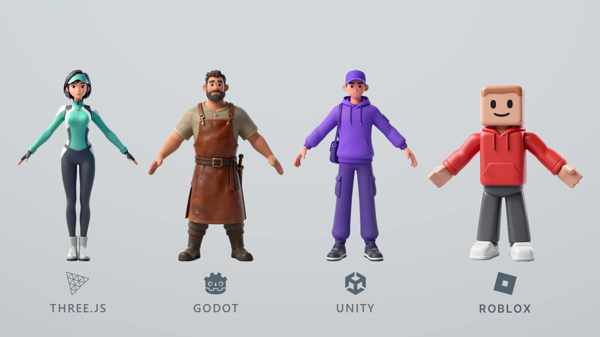

# 3GS_Master

Среда, в которой AI-агент делает игры для четырёх движков - **Three.js**, **Godot 4**,
**Unity 6** и **Roblox Studio (Luau)**. RAG по документации каждого движка, MCP-серверы
знаний и ассетов, генерация арта и 3D на одной видеокарте 8 ГБ.



По умолчанию агент работает на локальной модели; облачную можно подключить вместо
неё или вести сессию сразу на двух.

## Требования

- Windows, Python 3.11+ (`.venv` в корне)
- **~36 ГБ весов** (скачиваются одной командой, см. ниже) и бинарники в `bin/` - в git
  они не входят
- 8 ГБ VRAM: на карте одновременно живёт одна модель - LLM, генератор картинок
  или ComfyUI

## Модели: скачать

Веса в git не входят: клон получает код и пустой `models/`. Что именно нужно и откуда
это брать, записано в [`models.manifest.json`](models.manifest.json) - на каждый файл
репозиторий на HuggingFace, точный размер и `sha256`.

```cmd
setup.cmd                      :: venv + зависимости + веса + doctor, одной командой
gs models --verify             :: пересчитать хеши
```

`setup.cmd` идемпотентен: повторный запуск ничего не перекачивает. `setup.cmd --no-models`
создаёт окружение без весов, `--mirror` качает через hf-mirror.com.

`gs models --fetch` качает только отсутствующее, докачивает с места обрыва (`.part` + `Range`) и
сверяет `sha256` на лету - недокачанный файл никогда не станет похож на рабочий.
Плохая связь с HuggingFace - добавь `--mirror` (hf-mirror.com).

Можно взять не всё:

| группа | размер | что это | нужна для |
|---|---|---|---|
| `llm` | 2.7 ГБ | Qwen3.5-4B Q4_K_M | агент (роутер :8080) |
| `rag` | 1.1 ГБ | `bge-m3` + `bge-reranker-v2-m3` | поиск по документации |
| `vlm` | 5.5 ГБ | Qwen2.5-VL-7B + mmproj | «посмотри на скриншот» (:8082) |
| `image` | 6.5 ГБ | z-image-turbo + VAE + текстовый энкодер | текст → картинка (:8687) |
| `3d` | 13.3 ГБ | Pixal3D, MoGe, TripoSplat, BiRefNet | картинка → GLB (ComfyUI :8188) |
| `3d-x` | 6.5 ГБ | бэкбон Trellis2 (`switch=True`) | альтернатива Pixal3D |

```cmd
gs models --fetch llm,rag      :: 3.8 ГБ - хватает на агента и RAG
gs models --fetch all          :: включая необязательный 3d-x
gs models --verify rag --strict
```

**3D отдельно:** модели `3d` кладутся внутрь ComfyUI, поэтому сначала сам движок -
портативная сборка `ComfyUI-Easy-Install` (~14 ГБ со `python_embeded` и `torch`, в git
её нет). `--fetch` скажет, куда именно, если её нет; после установки ComfyUI повтори
команду. Итог по диску: ~36 ГБ весов из манифеста плюс эта сборка.

## Модели: где лежат

**По умолчанию всё качается внутрь репозитория** - `<repo>/models`, ничего настраивать
не нужно. Переменные ниже нужны только чтобы взять веса из другого каталога:

| переменная | по умолчанию | что покрывает |
|---|---|---|
| `LOCAL_LLM_MODELS` | пусто | общий корень весов на машине: его читает и 3GS Master, и hc_local_ai_image_3D |
| `GS_MODELS_ROOT` | `<repo>/models` | побеждает общий корень; всё: чат-GGUF, эмбеддер, реранкер, VLM, z-image, ComfyUI |
| `GS_LLM_MODELS_DIR` | пусто | доп. корни **только** для чат-моделей, через `;` |

Абсолютных путей в коде нет - буква диска не зашита нигде. Если веса лежат на другом
диске, это одна строка в `local.env.cmd` (копия `local.env.example.cmd`, в git не попадает):

```cmd
copy local.env.example.cmd local.env.cmd
:: затем в local.env.cmd:
set "GS_MODELS_ROOT=D:\AI\Models"
```

Ещё удобнее - задать общий корень один раз на машину, тогда его подхватят оба проекта
без правки их файлов:

```cmd
setx LOCAL_LLM_MODELS "D:\AI\Models"
```

Уже скачанные веса переезжают туда обычным копированием:

```cmd
robocopy models D:\AI\Models /E /MOVE
```

Проверить, что где лежит и чего не хватает:

```cmd
gs models --paths
```

Раскладка внутри корня: `*.gguf` в корне (4B чат, `bge-m3`, `bge-reranker`),
`vlm/Qwen2.5-VL-7B/`, `image/z-image-turbo/`, `text_image_3D/` (ComfyUI и его 3D-модели).
Этот же корень читают все четыре движка, роутер llama.cpp на :8080, `vlm.cmd`,
`sd-image.cmd`.

hc_local_ai_image_3D - отдельный проект со своим кодом и своим `.env`; 3GS Master для
него не нужен. Совпадать у них может только папка с весами, и совпадает она через
`LOCAL_LLM_MODELS`: ни один из проектов не знает пути другого.

## Быстрый старт

```cmd
git clone https://github.com/CityStas/3gs_master
cd 3gs_master
setup.cmd                         :: venv + зависимости + ~36 ГБ весов + doctor
dev.cmd my_game
```

`setup.cmd` можно прервать и запустить снова - докачает с места обрыва. Отдельно
`gs doctor` проверяет окружение целиком, `dev.cmd <имя>` поднимает модели
(`serve-all.cmd`), проверяет окружение и открывает консольного агента `pi` в
`projects/three/<имя>`; папка создаётся **пустой**, стек раскладывается отдельно.
`dev.cmd <имя> --studio` вдобавок открывает редактор уровней в отдельном окне
(`studio.cmd <имя> --no-models`) - это работает только для Three.js.

**Веса нужны только агенту.** Студия стартует без моделей и без `setup.cmd`:
достаточно `.venv` (`python -m venv .venv`) и `studio.cmd` - см. следующий раздел.

## Студия Three.js: один файл

Двойной щелчок по `studio.cmd` (или `gs studio`) поднимает **пустую** студию:
без проекта, без консольного меню и без моделей. Проект выбирается уже в UI:

- список содержит **только** `projects/three/<имя>` - это редактор three.js-сцен,
  поэтому Roblox/Unity/Godot в нём не предлагаются;
- выбор проекта уходит на `POST /__open`, сервер переключает корень **на живом
  соединении**, страница перезагружается и загружает уровни, ассеты и игру;
- `+ Создать и открыть` зовёт `POST /__new` -> канонический
  `tools/project_init.py` раскладывает полный стек в `projects/three/<имя>`;
- `✕` у селектора возвращает пустую студию (`POST /__close`).

Адрес `http://127.0.0.1:8777/web3d/studio.html`; другой порт -
`studio.cmd --port 8788`. Оболочка одна на все проекты и лежит в `studio/`
репозитория: `launcher.js` не имеет импортов и работает вообще без проекта, а
`app.js` (ему нужны `scene.js` и `vendor/three` из каталога игры) подгружается
динамически **только после выбора**. Модели студии не нужны: флаг `--models`
нужен лишь когда параллельно работает консольный агент `pi`.

Совместимость сохранена: `studio.cmd three/my_game` сразу открывает конкретный
проект, `studio.cmd three/my_game 8788` - тот же проект на другом порту.
Подробности, вкладки и формат правок - [`STUDIO.md`](STUDIO.md).

### Где лежат `.cmd` и что из них нужно

Реальных лаунчеров 41: 10 в корне и 31 в `cmd\`. Все вызываются через единый
фасад `gs.cmd` (`gs help` печатает полный список), напрямую запускать их не
обязательно.

| Где | Что | Зачем |
| --- | --- | --- |
| корень | `gs.cmd` | единый фасад, `gs <подкоманда>` |
| корень | `studio.cmd`, `dev.cmd`, `agent.cmd`, `resume.cmd`, `serve-all.cmd`, `pi-here.cmd`, `setup.cmd` | повседневные лаунчеры |
| корень | `local.env.example.cmd` / `local.env.cmd` | шаблон и локальная конфигурация (в git не попадает) |
| `cmd\` | 31 сервисный лаунчер, включая `cmd\_env.cmd` | общие переменные, RAG, модели, генерация арта, проверки четырёх движков |
| `archive\legacy\` (локально) | `web1.cmd`, `launch_studio.cmd`, `studio_new_test\` | устаревшие/тестовые: перенесены, **не удалены**, но `archive/` закрыт в `.gitignore` и в репозиторий не попадает |
| `m2m\node_modules\.bin\`, `models\...\python_embeded\` | автогенерируемые shims npm/ComfyUI | не лаунчеры репозитория, не трогать |

`web1.cmd` ссылался на несуществующий `projects/research/web_1`,
`logs\launch_studio.cmd` - на жёстко зашитую версию RobloxStudioBeta.exe; оба
нигде не упоминаются. В репозитории эти файлы удалены/перенесены, структура
четырёх движков (`projects/{three,godot,unity,roblox}`, `knowledge/`,
`godot/knowledge/`, `roblox/knowledge/`, `unity/knowledge/`, `pi-home-*`) не изменена.

## Четыре движка: как это работает на самом деле

Проект - папка `projects/<движок>/<имя>`. Раскладку знает **один** модуль
[`project_layout.py`](project_layout.py): `ENGINE_FOLDERS = ("three", "godot", "unity", "roblox")`.
Он же решает, куда положить новый проект по голому имени и какой профиль агента
подключить. Второго, «legacy» родителя нет - `projects/games/` больше не ищется.

| Движок | Папка | Маркер `engine.json` | Профиль `pi` | Как появляется скелет |
| --- | --- | --- | --- | --- |
| Three.js | `projects/three/<имя>` | `{ "engine": "threejs" }` | `pi-home-three` | `gs init projects\three\<имя> --engine threejs` или «+ Создать и открыть» в студии |
| Godot 4 | `projects/godot/<имя>` | `{ "engine": "godot" }` | `pi-home-godot` | новый проект в Godot Project Manager в этой папке |
| Unity 6 | `projects/unity/<имя>` | `{ "engine": "unity" }` | `pi-home-unity` | Unity Hub или MCP `unity_project_create` |
| Roblox | `projects/roblox/<имя>` | `{ "engine": "roblox" }` | `pi-home-roblox` | `gs roblox-index`, затем `gs roblox-open` |

Поле `version` (`"r186"`, `"4.7.2"`, `"6000.3"`) - **только подпись для человека**:
ни лаунчеры, ни гейты его не читают, решение принимает одно поле `engine`.
Четыре `projects/<движок>/engine.json` закоммичены как маркеры папок; для
Godot/Unity/Roblox свой маркер в папке проекта обязателен (см. оговорку ниже).

`cmd\init.cmd` инициализирует **по маркеру** и раскладывает three.js-стек ТОЛЬКО для
`threejs`; для остальных движков он ничего не пишет, чтобы не засорять чужой проект.
Голое имя разрешается относительно **текущего каталога**: `cmd\init.cmd my_game` из
корня репозитория создаст `<repo>\my_game` вне `projects/` (скрипт предупредит, что
студия и гейты его не увидят). Из корня передавайте полный путь
`projects\three\<имя>`, либо создавайте проект кнопкой в студии - она подставляет
корректный путь сама. `dev.cmd <имя>` создаёт папку пустой и вообще не раскладывает
стек.

**Движок → инструменты.** `agent.cmd` читает `<проект>/engine.json`, ставит
`PI_CODING_AGENT_DIR=pi-home-<движок>` (оттуда `SYSTEM.md`, скиллы, `mcp.json`), а
`pi-extensions/engine-gate.ts` по тому же маркеру регистрирует только MCP-серверы
своего движка. Единственный реестр - [`mcp/registry.json`](mcp/registry.json) с
полем `engines`; разложить его по профилям и WorkBuddy: `gs mcp-sync --apply`.
`assets` доступен всем четырём, RAG-серверы (`threejs-rag`, `godot-rag`,
`unity-rag`, `rbx-rag`) - только своему движку.

**Оговорка про наследование.** `project_layout.nearest_engine()` (Python-стеки,
MCP-серверы, `tools/pi_launch.py`, `tools/project_context.py`) умеет подняться к
маркеру папки движка. Но `agent.cmd`, `pi-here.cmd` и `engine-gate.ts` читают маркер
**самого проекта** и без него берут дефолт `threejs`. Поэтому проекту Godot/Unity/Roblox
нужен собственный `engine.json`, иначе сессия получит Three.js-профиль, даже лёжа в
`projects/godot/`. Подробности - [`projects/README.md`](projects/README.md).

### RAG и команды по движкам

| Движок | Корпус | В git | Индекс и проверки |
| --- | --- | --- | --- |
| Three.js | `knowledge/` (r186 API, исходники, cookbook, правила) | да | `gs index`, `gs check <имя>` |
| Godot 4 | `godot/knowledge/` | да | `.venv\Scripts\python.exe godot\tools\gdm.py index` (CLI: `doctor` / `status` / `search`); отдельной `gs`-подкоманды нет |
| Unity 6 | `unity/knowledge/` | **нет** | `gs unity-fetch` → `gs unity-index` → `gs unity-check` / `gs unity-doctor` |
| Roblox | `roblox/knowledge/` (2456 `.md`) | да | `gs roblox-index` (индекс ~249 МБ, в git не входит), `gs roblox-check` / `gs roblox-doctor` / `gs roblox-save` |

Корпус общий для всех проектов движка и в папку проекта не копируется.
`gs roblox-fetch` / `gs unity-fetch` нужны лишь чтобы обновить корпус; у Unity без
`unity-fetch` корпуса нет вообще.

Встроенный MCP Studio включается **внутри Roblox Studio**: Assistant → … →
Manage MCP Servers → Enable Studio as MCP server. Из репозитория это не настраивается.

Дальше - `dev.cmd <имя>` (модели + `doctor` + агент). Инструменты движка появляются
у агента только под проект с соответствующим `engine.json`.

## Что попадает в репозиторий

**Никаких готовых игр в репозитории нет.** Клон получает код, корпуса знаний и пустой
скелет `projects/`:

```cmd
git ls-files projects
```

Ровно шесть строк: `projects/.gitignore`, `projects/README.md` и четыре `engine.json`.
Содержимое `projects/*` закрыто в [`.gitignore`](.gitignore), исключения открывают
только маркеры. Также не версионируются `models/`, `bin/`, `.venv/`, `logs/`,
`data/active_project.txt`, `local.env.cmd`, индексы `data/sqlite/`,
`unity/knowledge/`, `roblox/data/`, `output/`, `m2m/` и локальный `archive/`.
Поэтому свежий клон всегда стартует с **пустым списком проектов в студии** - это
норма, а не потеря данных; проект создаётся в UI или командами выше.

## Документация

- [`docs/ARCHITECTURE.md`](docs/ARCHITECTURE.md) - архитектура, лаунчеры, MCP, диагностика
- [`AGENTS.md`](AGENTS.md) - правила агента
- [`ASSET-POLICY.md`](ASSET-POLICY.md) - откуда берутся ассеты
- [`LEVEL-SCHEMA.md`](LEVEL-SCHEMA.md), [`STUDIO.md`](STUDIO.md) - уровни и студия (Three.js)
- [`projects/README.md`](projects/README.md), [`project_layout.py`](project_layout.py) - раскладка проектов и маркеры движков
- [`godot/README.md`](godot/README.md) - Godot-стек (gdmaster)
- [`unity/README.md`](unity/README.md) - Unity-стек
- [`roblox/README.md`](roblox/README.md) - Roblox-стек (Luau, Studio MCP, корпус)
- [`mcp/registry.json`](mcp/registry.json) - единственное описание MCP-серверов для pi и WorkBuddy
