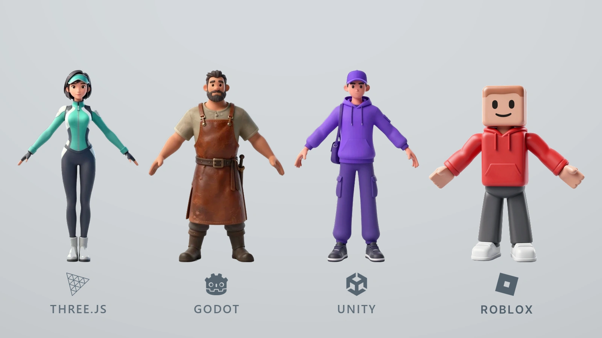

# 3GS_Master

Среда, в которой AI-агент делает игры для четырёх движков - **Three.js**, **Godot 4**,
**Unity 6** и **Roblox Studio (Luau)**. RAG по документации каждого движка, MCP-серверы
знаний и ассетов, генерация арта и 3D на одной видеокарте 8 ГБ.



По умолчанию агент работает на локальной модели; облачную можно подключить вместо
неё или вести сессию сразу на двух.

## Требования

- Windows, Python 3.11+ (`.venv` в корне)
- веса моделей в `models/` и бинарники в `bin/` - в репозиторий не входят,
  порядок установки описан в [`docs/ARCHITECTURE.md`](docs/ARCHITECTURE.md)
- 8 ГБ VRAM: на карте одновременно живёт одна модель - LLM, генератор картинок
  или ComfyUI

## Быстрый старт

```cmd
git clone https://github.com/CityStas/3gs_master
cd 3gs_master
dev.cmd test
dev.cmd my_game
```

`dev.cmd <игра>` поднимает нужные сервисы, проверяет окружение и открывает агента
в папке игры. Флаг `--studio` добавляет редактор уровней (только для Three.js).

## Новый проект

Проект - это папка `projects/games/<имя>`. Движок задаёт файл `engine.json` в её
корне; без него агент работает в режиме Three.js.

| Движок | `engine.json` | Что сделать перед запуском |
| --- | --- | --- |
| Three.js | `{ "engine": "threejs", "version": "r186" }` | ничего, скелет ставит `cmd\newgame.cmd <имя>` |
| Godot 4 | `{ "engine": "godot", "version": "4.7.2" }` | создать проект в Godot Project Manager в этой папке |
| Unity 6 | `{ "engine": "unity", "version": "6000.3" }` | создать проект в Unity Hub или дать это агенту |
| Roblox | `{ "engine": "roblox" }` | `gs roblox-fetch`, `gs roblox-index`, затем `gs roblox-open` |

Для Roblox дополнительно нужны две вещи, которых нет у остальных движков: корпус
документации скачивается отдельно (`gs roblox-fetch`, ~3600 страниц), а встроенный MCP
Studio включается **внутри Studio** - Assistant → … → Manage MCP Servers → Enable
Studio as MCP server.

Дальше - `dev.cmd <имя>`. Инструменты движка появляются у агента только под проект
с соответствующим `engine.json`.

## Документация

- [`docs/ARCHITECTURE.md`](docs/ARCHITECTURE.md) - архитектура, лаунчеры, MCP, диагностика
- [`AGENTS.md`](AGENTS.md) - правила агента
- [`ASSET-POLICY.md`](ASSET-POLICY.md) - откуда берутся ассеты
- [`LEVEL-SCHEMA.md`](LEVEL-SCHEMA.md), [`STUDIO.md`](STUDIO.md) - уровни и студия (Three.js)
- [`unity/README.md`](unity/README.md) - Unity-стек
- [`roblox/README.md`](roblox/README.md) - Roblox-стек (Luau, Studio MCP, корпус)
- [`mcp/registry.json`](mcp/registry.json) - единственное описание MCP-серверов для pi и WorkBuddy

## Что в репозитории, а что нет

В git лежит код, корпус документации и конфигурация агента. Исключены веса моделей,
бинарники движков, кэши RAG, пользовательские проекты и логи - поэтому клон без
дополнительных шагов не запустится: сначала нужны модели и `.venv`.
